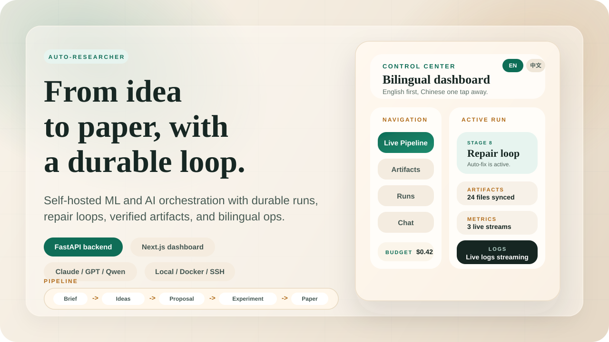
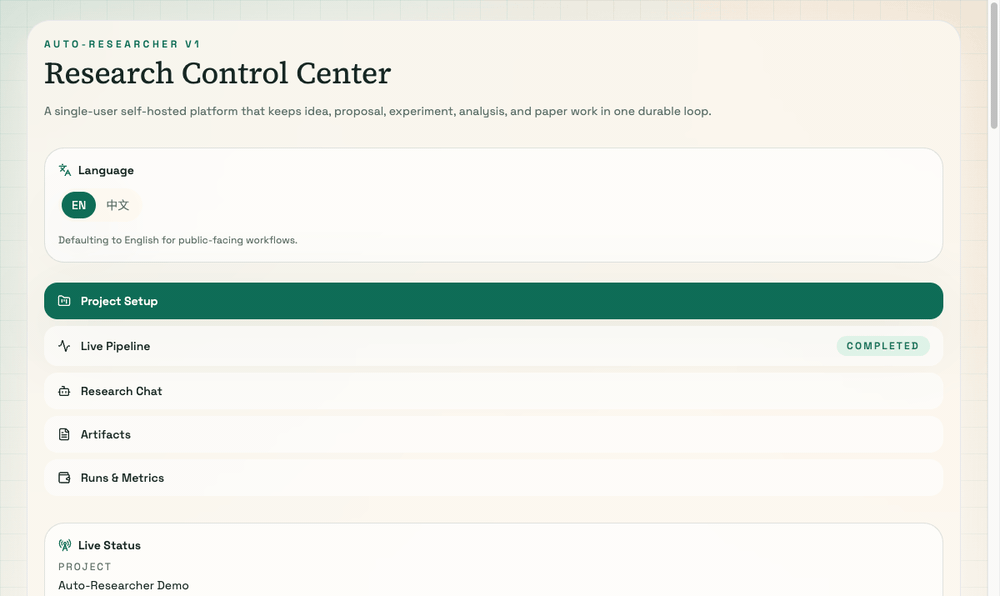
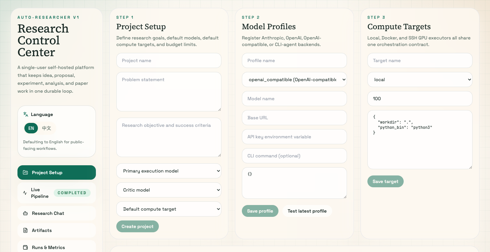
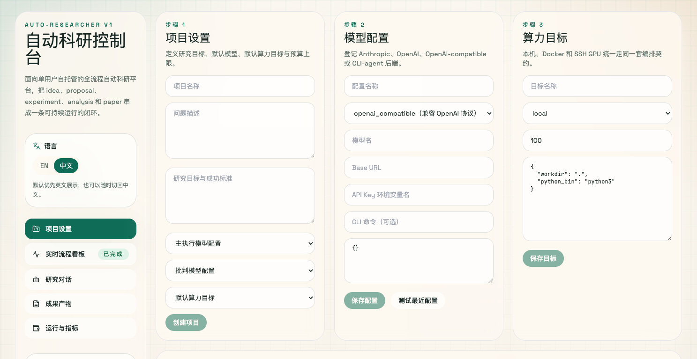
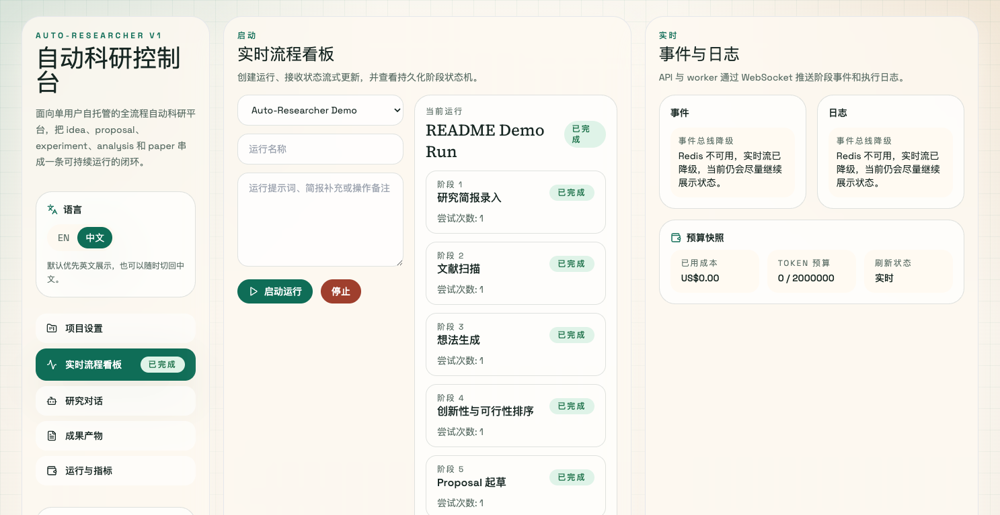
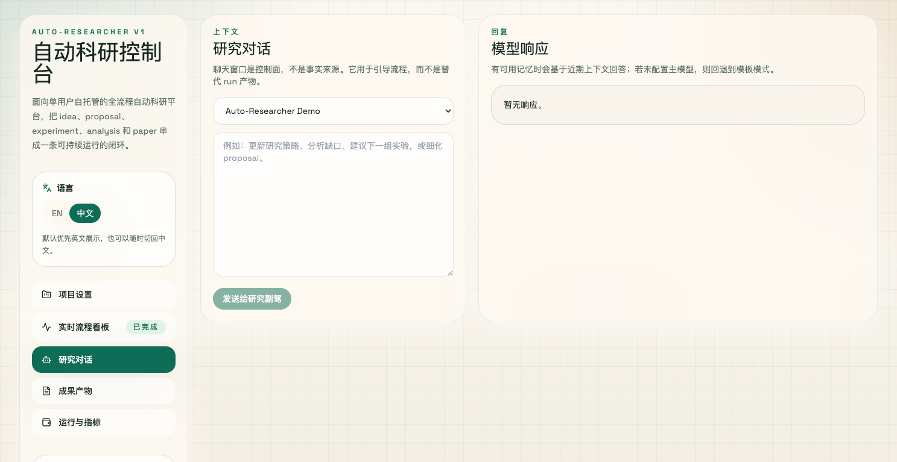
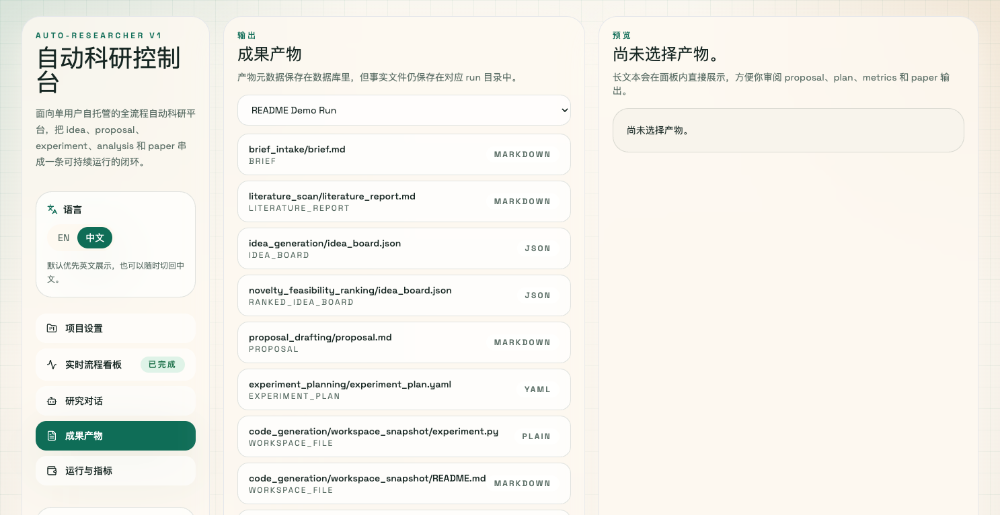
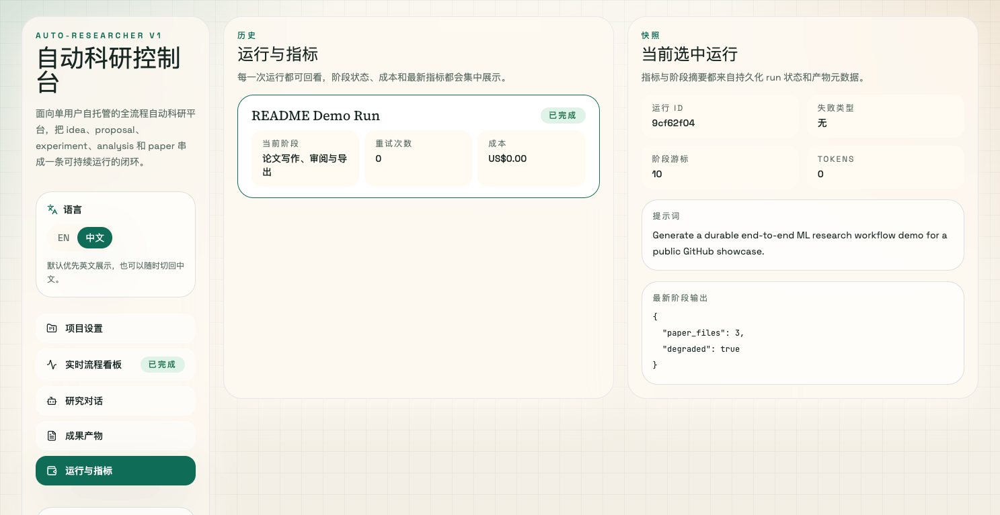

# Auto-Researcher

[](https://github.com/Haoqin860/auto-researcher/actions/workflows/ci.yml)
[](./LICENSE)
[](https://github.com/Haoqin860/auto-researcher/discussions)

[中文说明](./README.zh-CN.md) | English



Auto-Researcher is a single-user, self-hosted ML/AI research platform that automates the full workflow from research brief to proposal, experiment planning, execution, analysis, and paper drafting.

It combines a durable orchestration backend, pluggable model providers, reproducible experiment runtimes, and a web control plane built for long-running autonomous research loops.

## Product Demo

The GIF below is captured from a real local run of the app. It shows the English-first dashboard, live pipeline board, artifact review, and the built-in Chinese toggle.



<details>
<summary>Full dashboard screenshots</summary>












</details>

## Platform Architecture & Application Pages

The upgraded application provides an enterprise-ready, multi-page SaaS structure while strictly preserving all underlying research engine capabilities:

- **Landing Page (`/`)**: Modern product showcase featuring a dynamic hero, interactive 10-stage pipeline overview, core architecture breakdown, research capabilities grid, and authentication CTAs.
- **Operator Authentication (`/auth/login`, `/auth/register`)**: Real, secure JWT-based authentication with bcrypt password hashing, form validation, visibility toggles, and automatic redirect to dashboard upon authentication.
- **User Dashboard (`/dashboard`)**: Central command center displaying live research metrics (active projects, total runs, success rates, token usage), budget health meters, recent activity logs, and quick project setup triggers.
- **Research Console (`/dashboard/research`)**: 100% preservation of the original 5-pane research control center (Project Setup, Model Profiles, Compute Targets, Live Pipeline, Research Chat, Artifacts, Runs & Metrics, WebSockets, bilingual toggle).
- **Settings & Config (`/dashboard/settings`)**: Operator profile management, model routing configuration, compute node status, and platform health telemetry.

The platform is split into explicit control-plane, orchestration, and execution boundaries so long-running research loops stay recoverable and inspectable.

- `Control Plane`: Next.js 15 App Router web application with modern Tailwind CSS styling, responsive layout, and bilingual support.
- `API Layer`: FastAPI + WebSockets for authentication, projects, providers, compute targets, runs, artifacts, and realtime streams.
- `Durable Orchestrator`: A DB-backed worker loop with leases, retries, checkpoints, recovery, and repair routing.
- `Execution + Storage`: `local`, `docker`, and `ssh` runtimes plus durable state for logs, metrics, memories, citations, and paper outputs.

For the longer architectural walkthrough, see [docs/architecture.md](./docs/architecture.md).

## Highlights

- End-to-end 10-stage research pipeline:
  `brief intake -> literature scan -> idea generation -> novelty/feasibility ranking -> proposal drafting -> experiment planning -> code generation -> experiment run/refine loop -> analysis/result-to-claim -> paper drafting/review/export`
- Durable database-backed orchestration with leases, heartbeats, retries, checkpoints, and restart-safe recovery
- Multi-provider LLM gateway:
  `anthropic_native`, `openai_native`, `openai_compatible`, and `cli_agent`
- Compute target abstraction for `local`, `docker`, and `ssh` execution
- Bilingual operator dashboard with English default and Chinese toggle
- Artifact-first design with auditable outputs written to `artifacts/<project_id>/<run_id>/...`
- Citation verification workflow for proposal, analysis, and paper stages

The system is organized into six runtime subsystems:

1. `Provider Gateway` for model routing and connectivity checks
2. `Research Orchestrator` for run/stage/task state transitions
3. `Tool & Retrieval Hub` for literature search and citation verification
4. `Experiment Runtime` for local, Docker, and SSH execution
5. `Artifact & Memory Store` for stage outputs and durable metadata
6. `Realtime API` for event/log streaming over WebSocket

Core stack:

- Backend: FastAPI, SQLAlchemy, PostgreSQL, pgvector-ready schema, Redis
- Worker: Python asyncio with durable DB state machine
- Frontend: Next.js, TypeScript, Tailwind CSS

## Repository Layout

```text
.
├── backend/     FastAPI API, worker, orchestration engine, retrieval, runtime adapters
├── frontend/    Next.js dashboard and UI components
├── infra/       Dockerfiles and docker-compose stack
├── docs/        Architecture notes, data contracts, and runbook
├── scripts/     Local start/stop helper scripts
└── artifacts/   Generated research artifacts (kept empty in the published repo)
```

This published repository intentionally excludes local databases, runtime logs, generated artifacts, vendored reference projects, and machine-specific caches.

## Quick Start

### Option A: Full stack with Docker Compose

1. Copy the environment template:

```bash
cp .env.example .env
```

2. Fill in the provider keys you plan to use:

- `OPENAI_API_KEY`
- `ANTHROPIC_API_KEY`
- `QWEN_API_KEY`
- `DEEPSEEK_API_KEY`
- `SEMANTIC_SCHOLAR_API_KEY` (optional but recommended)

3. Start the stack:

```bash
docker compose -f infra/docker-compose.yml up --build
```

4. Open the services:

- Frontend: [http://localhost:3000](http://localhost:3000)
- Backend API docs: [http://localhost:8000/docs](http://localhost:8000/docs)

### Option B: Stable local mode

This mode is useful when Docker is unavailable. It starts the backend API, worker, and frontend production server as local processes.

Prerequisites:

- Python 3.11+
- [`uv`](https://docs.astral.sh/uv/)
- Node.js 20+
- `npm`

Install dependencies once:

```bash
cd backend && uv sync
cd ../frontend && npm install
cd ..
```

Start everything:

```bash
# Linux / macOS / Git Bash:
bash scripts/local-up.sh

# Windows (PowerShell):
powershell -ExecutionPolicy Bypass -File scripts/local-up.ps1
```

Stop everything:

```bash
# Linux / macOS / Git Bash:
bash scripts/local-down.sh

# Windows (PowerShell):
powershell -ExecutionPolicy Bypass -File scripts/local-down.ps1
```

Local runtime logs are written to `output/runtime/`.

## Provider Support

Model access is normalized into four provider classes:

- `anthropic_native` for Claude via Anthropic API
- `openai_native` for GPT via OpenAI API
- `openai_compatible` for Qwen, DeepSeek, Kimi, GLM, OpenRouter, and compatible gateways
- `cli_agent` for external command-line based agents

Execution and critique models can be assigned independently so that proposal generation and critical review can come from different model families.

## Artifact Contract

Each run produces stage-scoped outputs such as:

- `brief.md`
- `literature_report.md`
- `idea_board.json`
- `proposal.md`
- `experiment_plan.yaml`
- `workspace_snapshot/`
- `run_metrics.json`
- `analysis_report.md`
- `claim_decision.json`
- `paper/`

The database stores metadata and relationships; the actual files remain in the artifact directory.

## Current Scope

Auto-Researcher v1 is intentionally focused:

- single-user, self-hosted deployment
- ML/AI-first research workflows
- default autonomous execution with explicit stop gates
- local, Docker, and SSH compute targets

Not included in v1:

- multi-user collaboration
- Kubernetes or Slurm schedulers
- cloud GPU leasing workflows
- mobile notifications

## Production Deployment & Cloud Launch

Auto-Researcher is designed for scalable production deployment across enterprise cloud providers:

- **Frontend Deployment**: Zero-config edge hosting on **Vercel** with Next.js 15, automated SSL, and security headers.
- **Backend & Worker**: Containerized deployment on **Railway**, **Render**, **Fly.io**, or **AWS ECS** running FastAPI and the persistent autonomous research daemon.
- **Database & Storage**: Managed **PostgreSQL 16** with `pgvector` (via Neon, Supabase, or RDS) and persistent volume storage for research artifacts.
- **Realtime Event Streaming**: **Upstash Redis** or managed Redis for low-latency pub/sub WebSocket synchronization.

For comprehensive operational runbooks:
- 🚀 **[Production Deployment Guide](./DEPLOYMENT.md)** — Step-by-step instructions for Vercel, Railway, and Docker Compose.
- 🔐 **[Environment Variables Reference](./ENVIRONMENT_VARIABLES.md)** — Complete dictionary of configuration keys and security guidelines.
- 🗄️ **[Database Migration Guide](./DATABASE_MIGRATION.md)** — SQLite to PostgreSQL transition runbook and connection pooling.
- ✅ **[Production Launch Checklist](./PRODUCTION_CHECKLIST.md)** — 20-point verification checklist before promoting to public traffic.

## Docs

- [Production Deployment Guide](./DEPLOYMENT.md)
- [Environment Variables Reference](./ENVIRONMENT_VARIABLES.md)
- [Database Migration Guide](./DATABASE_MIGRATION.md)
- [Production Launch Checklist](./PRODUCTION_CHECKLIST.md)
- [Architecture](./docs/architecture.md)
- [Data Contracts](./docs/data-contracts.md)
- [Operator Runbook](./docs/runbook.md)
- [Contributing Guide](./CONTRIBUTING.md)
- [Support Guide](./SUPPORT.md)
- [Security Policy](./SECURITY.md)
- [Code of Conduct](./CODE_OF_CONDUCT.md)
- [Release Checklist](./docs/release-checklist.md)

## Citation

Citation metadata is provided in [`CITATION.cff`](./CITATION.cff).

## License

This project is released under the [MIT License](./LICENSE).
