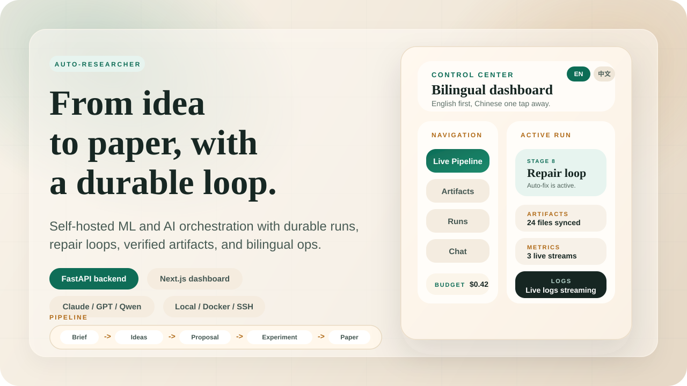
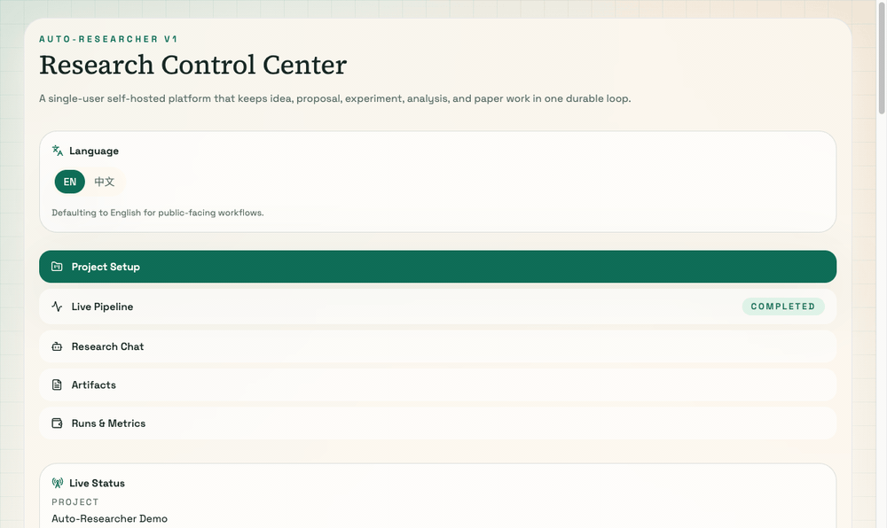
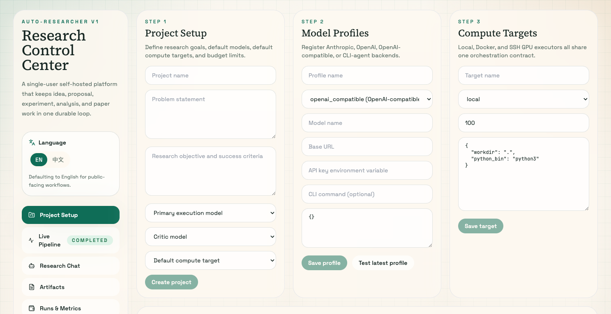
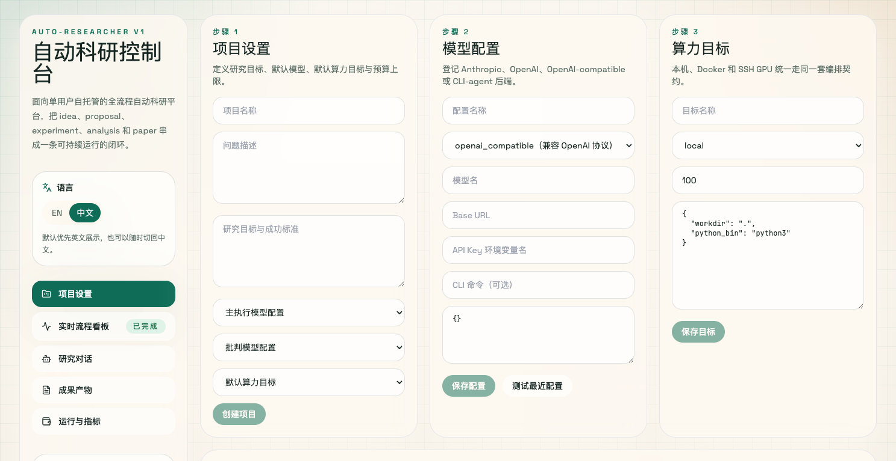
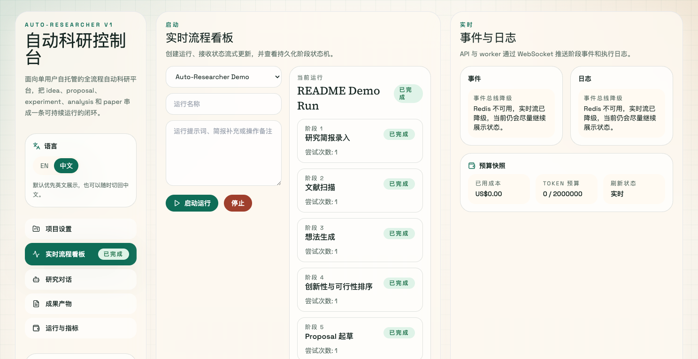
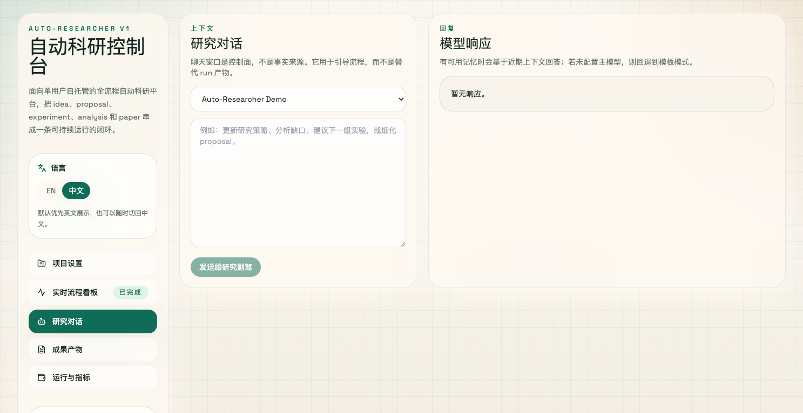
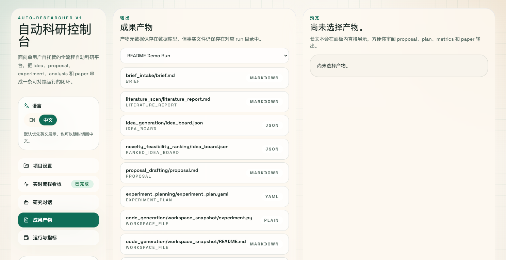
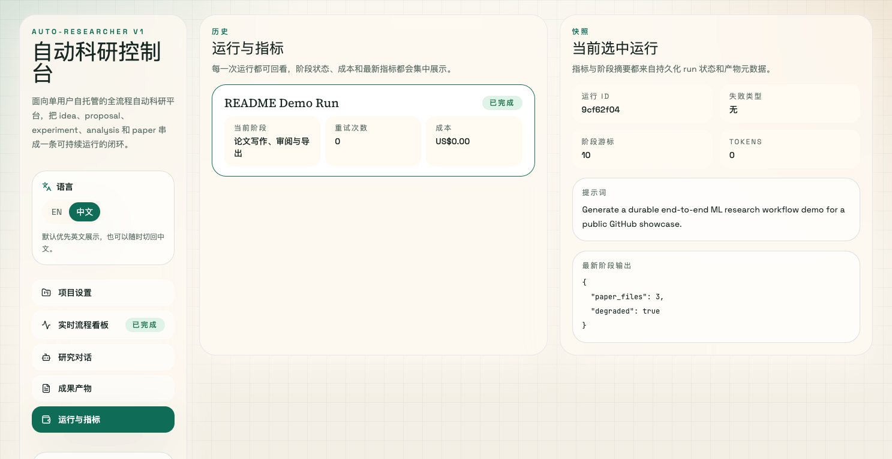

# Auto-Researcher

[](https://github.com/Haoqin860/auto-researcher/actions/workflows/ci.yml)
[](./LICENSE)
[](https://github.com/Haoqin860/auto-researcher/discussions)

中文 | [English](./README.md)



Auto-Researcher 是一个面向单用户、自托管场景的 ML/AI 自动科研平台，目标是把研究任务从研究简报、文献调研、idea 生成、proposal、实验规划与执行，一直到结果分析和论文草稿，串成一条可持续运行的自动化流程。

它的核心不是“单次 prompt 自动写点东西”，而是一套可恢复、可追踪、可长期运行的研究编排系统。

## 产品演示

下面这个 GIF 来自真实本地运行页面，展示了默认英文控制台、实时流程看板、产物预览，以及一键切换到中文面板的效果。



<details>
<summary>展开查看完整界面截图</summary>












</details>

## 平台架构与页面结构

系统现已升级为完整的企业级多页面 SaaS 结构，并 100% 完整保留了原有的科研编排能力：

- **产品首页 (`/`)**：现代化产品 Landing Page，包含产品定位、动态 10 阶段科研生命周期看板、核心技术架构概览、能力矩阵及登录入口。
- **操作员身份认证 (`/auth/login`, `/auth/register`)**：基于 JWT 与 bcrypt 的密码加密认证体系，提供表单校验、明文显隐切换及认证状态路由重定向。
- **科研总览工作台 (`/dashboard`)**：直观展示科研项目总览、运行状态指标、Token/预算消耗看板与快捷操作。
- **科研全能控制台 (`/dashboard/research`)**：完整保留原有的 5 大工作区（项目配置、模型管理、算力配置、实时流水线、科研对话、产物浏览器、运行记录与指标，支持中英文即时切换与实时 WebSocket 状态推送）。
- **系统设置与环境 (`/dashboard/settings`)**：管理科研人员身份信息、模型路由规则、计算节点状态及平台服务健康度。

整个平台把控制面、编排核心和执行平面拆成了明确边界，这样自动科研流程才能做到可恢复、可观测、可长期运行：

- `Control Plane`：基于 Next.js 15 App Router 的现代化控制台，具备响应式设计与中英双语支持
- `API Layer`：FastAPI + WebSocket，统一承载用户认证、项目、模型、算力目标、运行控制、产物查询和实时事件流
- `Durable Orchestrator`：数据库持久化 worker 循环，负责 stage 流转、retry、checkpoint、recovery 与 repair routing
- `Execution + Storage`：`local`、`docker`、`ssh` 三类执行器，以及日志、指标、memory、citation、paper 输出等持久化结果

更完整的架构说明可以看 [docs/architecture.md](./docs/architecture.md)。

## 核心特性

- 覆盖 10 个阶段的完整科研流水线：
  `brief intake -> literature scan -> idea generation -> novelty/feasibility ranking -> proposal drafting -> experiment planning -> code generation -> experiment run/refine loop -> analysis/result-to-claim -> paper drafting/review/export`
- 采用数据库持久化状态机，支持 lease、heartbeat、retry、checkpoint 与断点恢复
- 统一的多模型接入层：
  `anthropic_native`、`openai_native`、`openai_compatible`、`cli_agent`
- 统一的算力目标抽象，支持 `local`、`docker`、`ssh`
- 提供支持中英文切换的 Web 控制台，默认更适合英文开源受众展示
- 以 artifact 为核心，所有关键输出写入 `artifacts/<project_id>/<run_id>/...`
- 在 proposal、analysis、paper 阶段内置引用校验链路

系统由六个核心子系统组成：

1. `Provider Gateway`
   负责模型路由、配置管理和连通性检查
2. `Research Orchestrator`
   负责 run/stage/task 的持久化状态流转
3. `Tool & Retrieval Hub`
   负责文献检索、引用校验与证据收集
4. `Experiment Runtime`
   负责本机、Docker、SSH 三类执行器
5. `Artifact & Memory Store`
   负责产物写入和元数据索引
6. `Realtime API`
   负责事件与日志的 WebSocket 推送

默认技术栈：

- Backend：FastAPI、SQLAlchemy、PostgreSQL、Redis
- Worker：Python asyncio + 持久化状态机
- Frontend：Next.js、TypeScript、Tailwind CSS

## 仓库结构

```text
.
├── backend/     FastAPI API、worker、编排引擎、检索组件、执行器适配层
├── frontend/    Next.js 前端控制台
├── infra/       Dockerfile 与 docker-compose
├── docs/        架构说明、数据契约、运行手册
├── scripts/     本机一键启动/关闭脚本
└── artifacts/   运行产物目录（公开仓库中默认保持为空）
```

为了适合直接公开上传，这个发布版仓库已经刻意移除了：

- 本地数据库
- 运行日志
- 真实实验产物
- 外部参考仓库副本
- 机器相关缓存与依赖目录

## 快速开始

### 方式 A：使用 Docker Compose 启动完整栈

1. 复制环境变量模板：

```bash
cp .env.example .env
```

2. 填入你要使用的模型 API Key：

- `OPENAI_API_KEY`
- `ANTHROPIC_API_KEY`
- `QWEN_API_KEY`
- `DEEPSEEK_API_KEY`
- `SEMANTIC_SCHOLAR_API_KEY`（可选，但建议填写）

3. 启动服务：

```bash
docker compose -f infra/docker-compose.yml up --build
```

4. 打开页面：

- 前端：<http://localhost:3000>
- 后端 API 文档：<http://localhost:8000/docs>

### 方式 B：本机稳定模式

如果你本机没有 Docker，或者希望直接用本地进程运行，可以使用脚本模式启动。

前置依赖：

- Python 3.11+
- [`uv`](https://docs.astral.sh/uv/)
- Node.js 20+
- `npm`

首次安装依赖：

```bash
cd backend && uv sync
cd ../frontend && npm install
cd ..
```

启动：

```bash
# Linux / macOS / Git Bash:
bash scripts/local-up.sh

# Windows (PowerShell):
powershell -ExecutionPolicy Bypass -File scripts/local-up.ps1
```

关闭：

```bash
# Linux / macOS / Git Bash:
bash scripts/local-down.sh

# Windows (PowerShell):
powershell -ExecutionPolicy Bypass -File scripts/local-down.ps1
```

运行日志会写到 `output/runtime/`。

## 模型接入说明

系统统一支持四类模型接入方式：

- `anthropic_native`
  适合 Claude 原生 API
- `openai_native`
  适合 GPT 原生 API
- `openai_compatible`
  适合 Qwen、DeepSeek、Kimi、GLM、OpenRouter 以及兼容 OpenAI 协议的网关
- `cli_agent`
  适合通过命令行调用的外部 agent

你可以给“执行模型”和“批判模型”分别配置不同 provider，从而实现跨模型族互审。

## 产物契约

每一次 run 都会按阶段生成标准化产物，例如：

- `brief.md`
- `literature_report.md`
- `idea_board.json`
- `proposal.md`
- `experiment_plan.yaml`
- `workspace_snapshot/`
- `run_metrics.json`
- `analysis_report.md`
- `claim_decision.json`
- `paper/`

数据库主要保存索引关系与元数据，事实文件保存在 `artifacts/` 目录中。

## 当前版本边界

Auto-Researcher v1 当前聚焦于：

- 单用户自托管
- ML/AI 优先的科研工作流
- 默认自动执行到底
- 本机 / Docker / SSH 三类算力目标

当前暂未覆盖：

- 多用户协作
- K8s / Slurm 调度
- 云租卡自动化
- 移动端通知

## 文档

- [架构说明](./docs/architecture.md)
- [数据契约](./docs/data-contracts.md)
- [运行手册](./docs/runbook.md)
- [贡献指南](./CONTRIBUTING.md)
- [支持说明](./SUPPORT.md)
- [安全策略](./SECURITY.md)
- [行为准则](./CODE_OF_CONDUCT.md)
- [发布检查清单](./docs/release-checklist.md)

## 引用

如果你准备在论文或项目中引用本系统，可以直接使用仓库中的 [`CITATION.cff`](./CITATION.cff)。

## 许可证

本项目采用 [MIT License](./LICENSE) 开源。
